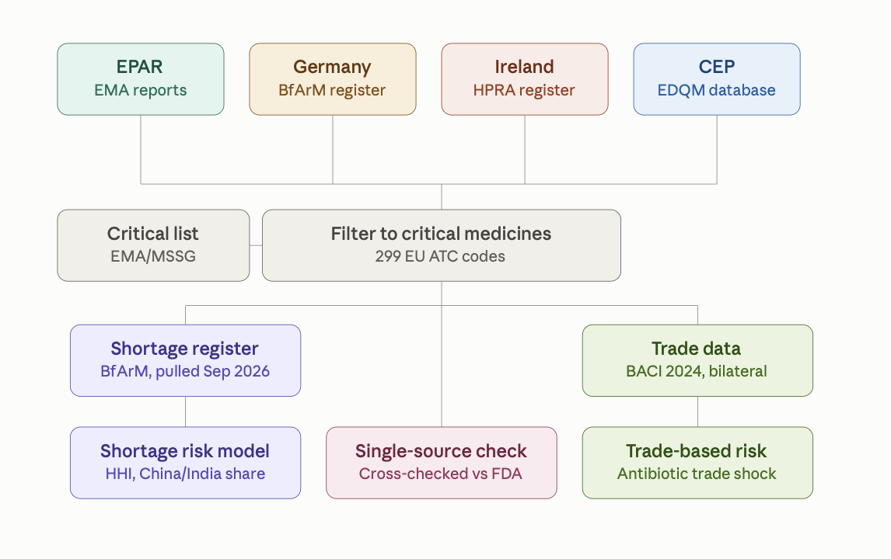

# Medication Supply: Manufacturing Concentration of EU Critical Medicines

This repository contains the data, code and figures for the paper by
E. Dervic, A. Pesce, L. Melnikova and P. Klimek (Supply Chain Intelligence Institute Austria,
Complexity Science Hub, Medical University of Vienna, TU Wien).

The paper builds the first open dataset that merges manufacturing-site information for the
299 medicines on the EU list of critical medicines from four public sources: the EMA's European
Public Assessment Reports (EPAR), the German BfArM manufacturer register, the Irish HPRA product
register and the EDQM database of Certificates of Suitability (CEP). It uses this dataset to measure
how geographically concentrated the manufacturing of each medicine is, to relate that concentration
to current shortages, to check apparently single-sourced medicines against FDA records, and to
estimate how exposed EU member states are to a halt in Chinese and Indian antibiotic exports.

## Table of Contents

- [Overview](#overview)
- [Repository structure](#repository-structure)
- [Data](#data)
- [Data collection](#data-collection)
- [Methods and scripts](#methods-and-scripts)
- [Paper figures and tables](#paper-figures-and-tables)
- [How to reproduce](#how-to-reproduce)
- [Known issues](#known-issues)
- [Independent replication (Python)](#independent-replication-python)
- [Contact](#contact)

## Overview



| Paper section | Status in this repository |
|---|---|
| Manufacturing registers and the Herfindahl-Hirschman Index | complete: data, scripts, figures and Table 1 |
| Data: manufacturing registers (descriptive overview) | complete |
| Shortage risk model (BfArM shortage register, logistic regression) | complete: data, script and results; reproduces every number in the paper |
| Data: critical medicines (treemap) and EU antibiotic consumption (ECDC) | complete: data, scripts and figures |
| Trade-based risk comparison (BACI) | notebook and figures included; its input data are not yet in the repository, so it cannot be rerun |
| Single-source medicines and alternative capacity (FDA cross-check) | to be added |
| Data collection (scraping the four registers) | scripts included; their output was corrected by hand, so they do not reproduce the register files exactly |

## Repository structure

```
data/
├── registers/
│   ├── raw/           the four manufacturer registers and the critical-medicines list (read-only)
│   └── processed/     combined, standardised register table written by the scripts
├── shortages/         BfArM shortage reports, pulled 9 September 2026
├── consumption/       ECDC antibiotic (J01) consumption, one file per year 2016–2024
├── trade/             trade-analysis inputs (BACI extract etc.; git-ignored, see "Data not included")
└── replication/       inputs of the independent Python replication (see below)
scripts/
├── run_all.R          runs every R analysis script in order
├── data_collection/   scrapers and download scripts that produced the raw register files
│   ├── BfArM/  CEP/  EPAR/  EudraGMDP/  HPRA/
├── registers/         R analysis of the registers
│   ├── paths.R
│   ├── 01_combine_sources.R … 08_api_diversification.R
│   └── 09_shortage_model.R
├── descriptives/      01_critical_treemap.R, 02_antibiotic_consumption.R
├── trade/             baci_systemic_risk.ipynb (trade-based risk, Python)
└── replication/       Python replication pipeline
figures/               figures used in the paper, file names as in the manuscript
├── trade/             trade figures of the paper and the Supplementary Information
└── additional/        per-source variants and diagnostic plots, not in the paper
results/
├── tables/            HHI per ATC code and source, Table 1, antibiotic consumption summary
├── shortage/          shortage model: merged per-code table and full model output
└── replication/       tables and figures of the Python replication
```

## Data

### Critical medicines

`data/registers/raw/critical.csv` lists the 299 ATC level-5 codes of the Union list of critical
medicines published by the EMA and the Medicine Shortages Steering Group (MSSG). Every analysis is
restricted to these codes and is carried out per ATC level-5 code.

### Manufacturer registers

| File in `data/registers/raw/` | Source | Collected | Content |
|---|---|---|---|
| `EMA_data_critical.csv` | EMA EPAR product information, Annex II | May 2026 | one row per medicine × manufacturing site, with country and manufacturing step (1 = active substance, 2 = finished product / batch release); restricted to critical ATC codes |
| `bfarm_api_origin_critical_rest_LONG.csv` | German BfArM register (AMGuiFree) | 25–26 June 2026 | one row per product × role × company; role is *Zulassungsinhaber* (marketing-authorisation holder), *Wirkstoffherstellung* (active-substance manufacture) or *Hersteller/Endfreigabe* (manufacture / batch release); country names in German; covers the critical ATC codes **except the 35 J01 antibiotics** (see [Known issues](#known-issues)) |
| `ireland_critical_atc_review.csv` | Irish HPRA product register | 2026 | one row per product with "\|"-separated lists of manufacturers and their countries; no manufacturing-step field;  restricted to critical ATC codes |
| `EXPORT_WEB_CEP.txt` | EDQM CEP certification database export | August 2026 | all certificates: substance, holder (name, city and ISO-2 country code in one field), status |
| `EXPORT_WEB_CEP_with_ATC_drugbank.csv` | `EXPORT_WEB_CEP.txt` with ATC codes attached via DrugBank | August 2026 | as above plus an `atc_code` column (comma-separated when several apply) |

All four registers were obtained from the publicly available online sources. Records were checked
manually and some rows were corrected by hand, so re-collecting the registers today will not give a
byte-identical result; the analysis in the paper uses the files in this folder.

After restriction to critical medicines the four sources cover:

| Source | ATC codes | Manufacturers | Countries |
|---|---|---|---|
| Germany (BfArM) | 251 | 1,824 | 48 |
| Ireland (HPRA) | 205 | 523 | 29 |
| CEP (EDQM) | 79 | 313 | 29 |
| EPAR (EMA) | 51 | 140 | 26 |

Together they cover 291 of the 299 critical ATC codes.

### Shortages

`data/shortages/LEMeldungen_2026-09-09-13-30-43.csv` is the export of all reports in the BfArM
shortage register (*Lieferengpassmeldungen*,
<https://anwendungen.pharmnet-bund.de/lieferengpassmeldungen/>), pulled on 9 September 2026:
739 reports, semicolon-separated, Latin-1 encoded, with the ATC code(s), start and expected end of
each shortage.

### Antibiotic consumption

`data/consumption/` holds nine files exported from the ECDC Antimicrobial Consumption (AMC)
database, one per year from 2016 to 2024: consumption of antibacterials for systemic use (ATC J01)
per EU/EEA country in defined daily doses (DDD) per 1,000 inhabitants per day. The year is read from
the file name.

### Trade

The trade analysis uses CEPII's BACI database (2024), restricted to the four HS-6 lines that carry
antibiotic active substances: 294110 (penicillins), 294130 (tetracyclines), 294150 (erythromycin and
macrolides) and 294190 (other antibiotics). These inputs are not yet in the repository; see below.

### Data not included in the repository

| Data | Why | How to obtain |
|---|---|---|
| DrugBank full database (`DrugBank_FullDatabase.xml`, 795 MB) | licence does not permit redistribution; size | Create a free academic account at <https://go.drugbank.com/releases/latest> and download "All drugs" (XML). Place it in `data/registers/raw/` (git-ignored). Only `scripts/data_collection/CEP/cep_atc_drugbank.R` reads it. |
| `data/trade/baci_2024_antibiotics_bilateral.csv` | not yet provided | The 2024 BACI flows for the four HS-6 lines, one row per exporter × importer × line with value (thousand USD) and quantity (tonnes). BACI: <https://www.cepii.fr/CEPII/en/bdd_modele/bdd_modele_item.asp?id=37>. The script that extracts it from BACI is not in the repository. |
| `data/trade/sys_risk/*.parquet` | not yet provided | Per-flow systemic trade risk scores (`str`) by HS code, importer and exporter. The notebook loads them in its setup cell; they are only used for the `str`-weighted variants, which the paper does not report. |
| `data/trade/cep_antibiotics_clean.csv` | not yet provided | Output of `scripts/data_collection/CEP/cep_clean.ipynb`, run on the CEP export of 28 July 2026. |
| `data/registers/raw/bfarm_api_origin_critical_J01_LONG.csv` | not yet provided | The BfArM scrape for the 35 J01 antibiotics (`scrape_bfarm_api_origin.py --j01`). Read by section 6 of the trade notebook. |
| `data/registers/raw/Critical_API_sites_activities_LONG.csv` | not yet provided | EudraGMDP API sites for critical codes, derived from the `scrape_eudragmdp_2026.py` output. Optional: without it `09_shortage_model.R` skips the V3 model, which the paper does not report. |

## Data collection

`scripts/data_collection/` contains the scripts that produced the raw register files. They document
how the data were obtained. They are not part of `run_all.R`: they scrape live websites, take hours,
and their output was checked and corrected by hand before it became the files in
`data/registers/raw/`. A new run gives the current state of each register, not the snapshot used in
the paper. See `scripts/data_collection/README.md` and the README in each subfolder.

| Register file | Produced by | Snapshot |
|---|---|---|
| `EMA_data_critical.csv` | `EPAR/ema_epar_pipeline.ipynb`: downloads the EMA medicines table, finds each medicine's product-information PDF, extracts the Annex II manufacturer blocks, parses name, address, country and step, and geocodes addresses | May 2026 |
| `bfarm_api_origin_critical_rest_LONG.csv` | `BfArM/scrape_bfarm_api_origin.py --rest`: opens the detail page of every product authorised in Germany for each critical code and records every company with its role and country | 25–26 June 2026 |
| `ireland_critical_atc_review.csv` | `HPRA/hpra_scraper.ipynb`: collects product information and package-leaflet links (phase 1), downloads the leaflets (phase 2) and extracts manufacturer, address and country (phase 3), then restricts to critical codes | 2026 |
| `EXPORT_WEB_CEP.txt` | `CEP/download_cep.py`: the EDQM "download the online certification database" export | August 2026 |
| `EXPORT_WEB_CEP_with_ATC_drugbank.csv` | `CEP/cep_atc_drugbank.R`: keeps valid certificates, matches substance names to DrugBank names and synonyms to get ATC codes, drops level-3/4 combination-product codes, cross-checks the remaining codes against NLM RxNav/RxClass, and attaches the codes to every row of the export | August 2026 |

`EudraGMDP/` downloads all EU GMP certificates (June 2026). Its output is used only for the optional V3
shortage model and is not part of the paper. `CEP/cep_clean.ipynb` prepares the CEP antibiotics table
for the trade notebook.

`cep_atc_drugbank.R` runs from the repository root, needs DrugBank in `data/registers/raw/`, writes
its intermediate tables to `data/registers/processed/cep_atc/`, and **overwrites**
`data/registers/raw/EXPORT_WEB_CEP_with_ATC_drugbank.csv`. The RxNav step makes about two API calls
per matched substance and caches them, so an interrupted run resumes.

## Methods and scripts

All R analysis scripts are run from the repository root. Input and output folders are set once in
`scripts/registers/paths.R`.

### Harmonising the four sources — `01_combine_sources.R`

Writes `data/registers/processed/manufacturer_registers_combined.csv`: one row per ATC code ×
manufacturer × country × manufacturing step × source, with the ATC level-1 chapter attached.

- **EPAR.** Manufacturer name, country and step are used as published. Rows whose "manufacturer"
  has no country are fragments of the PDF text (e.g. "B. CONDITIONS") and are dropped.
- **Germany.** Marketing-authorisation holders are not manufacturers and are dropped.
  *Wirkstoffherstellung* becomes step 1 and *Hersteller/Endfreigabe* step 2. German country names are
  translated to English, and both "Vereinigtes Königreich" variants map to United Kingdom.
- **Ireland.** The clean `matched_critical_atc` column is used, not the free-text `atc_code`; one row
  with two codes in that column is split. The parallel "|"-separated manufacturer and country lists are
  paired up element by element. Where the two lists differ in length, the row is kept unsplit rather
  than guessing a pairing. Trailing full stops in country names are removed.
- **CEP.** The export is not pre-filtered, so cells holding several ATC codes are split first and the
  result is then restricted to the critical codes. The holder's country is the trailing ISO-2 code of
  the holder field.
- In all sources whitespace in names is collapsed, so names that differ only by an embedded line break
  count as one manufacturer. Country spellings are unified across sources ("Italy." to Italy,
  "SPAIN" to Spain, "UK" to United Kingdom, "USA" to United States, "Republic of Korea" to South Korea).
- If `critical.csv` is missing, the scripts fall back to the union of ATC codes in the EPAR,
  German and Irish files, which are already restricted to critical medicines.

### Site identity and manufacturing step

A manufacturing site is identified by the BfArM site number (`pu_nummer`) for Germany, by
manufacturer name for EPAR and Ireland, and by certificate holder for CEP.

EPAR and Germany distinguish active-substance manufacture (step 1) from finished-product manufacture
and batch release (step 2). For the concentration measures (HHI, API diversification) a
**step-1 priority** rule applies: for each ATC code, step-1 records are used whenever at least one
exists, and step-2 records only for codes with no step-1 disclosure at all. Ireland has no step field
and all its manufacturers are used. CEP certificates identify the active-substance manufacturer directly, so no step distinction
applies.

### Country-level concentration — `03_hhi.R`

For each ATC code and source the Herfindahl-Hirschman Index is

$$\mathrm{HHI} = 10\,000 \sum_{i=1}^{n} s_i^2,$$

where $s_i$ is the share of the code's manufacturing sites located in country $i$. HHI is 10,000 when
all sites are in one country. The dashed lines in the figures mark 1,500 and 2,500, the conventional
thresholds for moderate and high concentration.

Writes `results/tables/hhi_step1_priority.csv` (one row per ATC code and source: number of
countries and sites, HHI, effective number of countries $10\,000/\mathrm{HHI}$). It also writes
`results/tables/hhi_highest_by_source.csv`: for each source, how often it
reports the highest HHI among all sources covering that code. Ties count for every tied source.

### Descriptive and geographic figures

| Script | What it computes |
|---|---|
| `02_plots_by_source.R` | totals of ATC codes, manufacturers and countries per source; manufacturers and countries per ATC code; top 10 manufacturing countries |
| `04_atc_summary.R` | number of distinct manufacturers against number of distinct countries per ATC code (hexagonal bins), per source |
| `05_bubble_matrix.R` | unique sites (dot size) and unique critical ATC codes (colour) per country × ATC chapter; non-EU/EEA countries in bold |
| `06_eea_by_step.R` | share of unique sites per ATC chapter that are EEA step 1, EEA step 2 or non-EEA. No step-2 records are dropped here: a site counts as step 1 if it has any step-1 record |
| `07_country_groups.R` | the same shares split into China / India / EU-EEA / Other, darker shade for step 1 |
| `08_api_diversification.R` | per substance, distinct API sites against share of those sites in China or India, step-1 priority. Substances with at most 30 sites and more than 65 % China+India share are labelled. For Ireland the product name stands in for the substance, since the register has no substance field |

### Shortage risk — `09_shortage_model.R`

Links the register data to the BfArM shortage register and asks which feature of a medicine's supply
base predicts that it is currently in shortage.

- **Outcome.** Multi-code cells in the shortage register are split. Reports carrying only an ATC
  level-4 code (21) or no ATC code (16) cannot be matched to one critical code and are dropped. A code
  is *currently in shortage* if any of its reports started on or before 9 September 2026 (the pull date)
  and has no end date or ends on or after it.
- **Predictors**, per ATC code, with the step-1 priority rule: number of distinct manufacturers,
  country-level HHI, and share of manufacturers located in China or India.
- **Bases.** V1 uses the German register alone (251 codes, 34 in shortage); V2 pools Germany and EPAR
  (259 codes, 35 in shortage). Ireland and CEP are left out because the German register is both the
  deepest source and the origin of the shortage data. An optional V3 (Germany + CEP + EudraGMDP API
  sites, with company names harmonised across registers) runs only if the EudraGMDP file is present.
- **Model.** Logistic regression of shortage status on log(1 + manufacturers), HHI/10,000 and the
  China+India share. Terms are tested with likelihood-ratio tests (type II), confidence intervals are
  profile-likelihood intervals, and the script reports McFadden's pseudo-R², in-sample AUC, variance
  inflation factors and confusion matrices. It also runs univariate Wilcoxon and point-biserial tests
  and Fisher tests of single-source status against shortage, which the paper does not report.

Outputs: `results/shortage/shortage_model_output.txt` (the full console output), 
`results/shortage/atc_shortage_concentration_analysis.csv` (one row per critical code with all
predictors and the shortage flag) and diagnostic plots in `figures/additional/shortage/`.

| | V1: Germany | V2: Germany + EPAR |
|---|---|---|
| China+India share, OR (95 % CI) | 8.6 (2.4–32.0), p < 0.001 | 9.6 (2.7–35.5), p < 0.001 |
| log manufacturers, p | 0.65 | 0.85 |
| HHI, p | 0.12 | 0.05 |
| McFadden's pseudo-R² | 0.08 | 0.08 |
| in-sample AUC | 0.71 | 0.71 |

### Critical medicines and antibiotic consumption — `scripts/descriptives/`

| Script | What it computes |
|---|---|
| `01_critical_treemap.R` | number and share of the 299 critical ATC codes per ATC level-1 chapter, as a treemap |
| `02_antibiotic_consumption.R` | J01 consumption per country and year (zeros are treated as missing), the EU/EEA mean per year with all country trajectories, a country × year heatmap, small multiples, and a per-country summary (min, max, mean, linear trend) in `results/tables/antibacterial_consumption_summary.csv` |

### Trade-based risk — `scripts/trade/baci_systemic_risk.ipynb`

Python notebook (pandas, numpy, scipy, matplotlib, pyarrow). It builds the sourcing-share matrix $S$
(each importer's import shares by exporter, pooled over the four HS-6 lines, by value and by volume) and
then computes, in order:

1. sourcing similarity: pairwise cosine similarity of EU-27 sourcing profiles, and (1b) a
   marginal-preserving null model with 1,000 permutations;
2. import exposure, imports / (imports + exports);
3. largest supplier and supplier concentration (HHI of import shares) per EU-27 country;
4. the fragility map, exposure against supplier concentration;
5. the China + India export-stop shock, direct and propagated through intermediaries,
   $x = (I - P)^{-1} a$ with $P = \mathrm{diag}(\text{exposure})\,S$, by value and volume, and (5b) a
   marginal-preserving null test (500 permutations) of the indirect part;
6. German register (BfArM, J01) against German imports (not in the paper);
7. CEP holders against EU-27 imports, with (7b) the non-EU split of Supplementary Table `cep_split`;
8. an exploratory unit-value screen (not in the paper).

The notebook resolves all paths from its own folder, so run it from `scripts/trade/` (Jupyter does
this by default). It reads its inputs from `data/trade/` and writes figures to `figures/trade/`. It
cannot be rerun until the inputs listed under [Data not included](#data-not-included-in-the-repository)
are added. The figures in `figures/trade/` are those in the manuscript, and the notebook keeps the
outputs of its last run.

## Paper figures and tables

| In the paper | File | Script |
|---|---|---|
| Fig. `fig:atc_summary_report` — manufacturers vs. countries per ATC code | `figures/atc_summary_report_plot_v2.png` | `04_atc_summary.R` |
| Fig. `fig:bubble_matrix_by_source` — country × ATC chapter footprint | `figures/bubble_matrix_by_source.png` | `05_bubble_matrix.R` |
| Fig. `fig:manufacturing_sites_by_chapter_step_source` — EEA / non-EEA by step | `figures/manufacturing_sites_by_chapter_step_source.png` | `06_eea_by_step.R` |
| Fig. `fig:manufacturing_sites_by_chapter_country_group_source` — China / India / EU-EEA / Other | `figures/manufacturing_sites_by_chapter_country_group_source.png` | `07_country_groups.R` |
| Fig. `fig:api_diversification_germany` — API diversification, Germany | `figures/api_diversification_Germany.png` | `08_api_diversification.R` |
| Fig. `fig:hhi_step1_priority_by_source` — HHI distribution per source | `figures/hhi_step1_priority_by_source.png` | `03_hhi.R` |
| Fig. `fig:hhi_by_chapter_by_source` — HHI by ATC chapter | `figures/hhi_by_chapter_by_source.png` | `03_hhi.R` |
| Table `tab:hhi_highest_by_sourceT` — source with the highest HHI | `results/tables/hhi_highest_by_source.tex` | `03_hhi.R` |
| Shortage model results (Results, no figure) | `results/shortage/shortage_model_output.txt` | `09_shortage_model.R` |
| Fig. `fig:cep_trade_scatter` — CEP holders vs. EU-27 import volume | `figures/trade/cep_vs_trade_scatter_volume_spearman.png` | trade notebook, §7 |
| Fig. `fig:exposure_fragility` (a) — import exposure | `figures/trade/exposure_volume.png` | trade notebook, §2 |
| Fig. `fig:exposure_fragility` (b) — fragility map | `figures/trade/fragility_volume.png` | trade notebook, §4 |
| Fig. `fig:shock` — China + India export stop | `figures/trade/shock_volume.png` | trade notebook, §5 |
| Fig. `fig:treemap_chapters` — critical APIs by ATC chapter | `figures/plot4_treemap_chapters.png` | `01_critical_treemap.R` |
| Fig. `fig:eu_antibiotic_trend` — J01 consumption 2016–2024 | `figures/eu_average_trend.png` | `02_antibiotic_consumption.R` |
| Fig. `fig:plots_by_source` — descriptive overview per source | `figures/plots_by_source.png` | `02_plots_by_source.R` |
| Single-source medicines and FDA cross-check | — | to be added |

Supplementary Information:

| In the SI | File | Script |
|---|---|---|
| Table `tab:cep_split` — non-EU partners with and without CEP holders | printed by the notebook | trade notebook, §7b |
| Figs. `fig:single`, `fig:single_val` — single-sourcing | `figures/trade/single_sourcing_volume.png`, `single_sourcing_value.png` | trade notebook, §3 |
| Fig. `fig:cosinenull` — sourcing-similarity null | `figures/trade/cosine_null.png` | trade notebook, §1b |
| Figs. `fig:exposure_val`, `fig:fragility_val`, `fig:shock_val` — value counterparts | `figures/trade/exposure_value.png`, `fragility_value.png`, `shock_value.png` | trade notebook, §2, §4, §5 |
| Fig. `fig:cosine` — cosine similarity matrices | `figures/trade/cosine.png` | trade notebook, §1 |

The single-source variants (`bubble_matrix_<source>.png`, `hhi_by_chapter_<source>.png`,
`api_diversification_<source>.png`), the earlier two-panel `atc_summary_report_plot.png`, the
consumption heatmap and small multiples, and the shortage-model diagnostic plots are in
`figures/additional/`.

## How to reproduce

Requirements: R ≥ 4.3 and, for the replication only, Python ≥ 3.11. The results in this repository
were produced with R 4.6.0 and Python 3.14.

```r
install.packages(c("readr", "dplyr", "tidyr", "ggplot2", "janitor", "stringr", "purrr",
                   "patchwork", "tidytext", "forcats", "scales", "ggrepel", "xtable", "hexbin",
                   "lubridate", "broom", "car", "pROC", "readxl", "treemapify"))
```

On macOS with a Homebrew R, `car` builds its dependency `nloptr` from source, which needs CMake
(`brew install cmake`). `cep_atc_drugbank.R` additionally needs `xml2`, `httr` and `jsonlite`.

From the repository root:

```bash
Rscript scripts/run_all.R
```

This runs `scripts/registers/01_…` to `09_…` and then `scripts/descriptives/01_…` and `02_…`
(about 15 seconds) and rewrites `data/registers/processed/`, `figures/` (except `figures/trade/`),
`results/tables/` and `results/shortage/`. `02`, `05` and `09` read the output of `01`; every other
script reads its raw data directly, so a single figure can be rebuilt with, for example,
`Rscript -e 'source("scripts/registers/03_hhi.R", encoding = "UTF-8")'`. Random label placement and
jitter are seeded, so repeated runs give identical files.

The trade notebook needs Python with `pandas numpy scipy matplotlib pyarrow jupyter` and its input data:

```bash
cd scripts/trade && jupyter nbconvert --to notebook --execute --inplace baci_systemic_risk.ipynb
```

**Locale.** The country-name maps contain non-ASCII names ("Vereinigtes Königreich"). In a non-UTF-8
locale, R reads these names in the scripts differently from the names in the data. The 1,276 German
rows for the United Kingdom then lose their country and the HHI of a few codes changes. `run_all.R`
therefore switches to a UTF-8 locale and stops if none is available. Run single scripts from RStudio
or a UTF-8 terminal.

## Known issues

Differences between the code, the data and the manuscript draft that the authors should resolve:

- **No J01 antibiotics in the German register file.** `bfarm_api_origin_critical_rest_LONG.csv` is the
  scraper's `--rest` run, so the 35 critical J01 codes are missing from every German result, including
  the shortage model. The J01 run (`bfarm_api_origin_critical_J01_LONG.csv`) exists but is used only by
  the trade notebook.
- **Consumption ribbon.** In `eu_average_trend.png` the shaded band is ± one standard deviation of the
  nine yearly EU means (`sd(EU_avg)`), the same width every year. The caption describes it as ± one
  standard deviation across countries.
- **Two CEP snapshots.** The register analysis uses the EDQM export from August 2026; the trade
  notebook uses the export of 28 July 2026 (9,388 rows), which is not in the repository.
- **Uniform-pooling sensitivity.** The Methods say the shock is repeated with $P = S$ and reported in
  the Supplementary Information. Neither the notebook nor SI.tex contains it.
- **Shortage results in the draft.** The abstract gives AUC = 0.72; the model gives 0.71. The
  Discussion gives odds ratios of 9.55–10.7; V1 and V2 give 8.6 and 9.6.

## Independent replication (Python)

`scripts/replication/` is a second, independently written pipeline. It is not used for any number in
the paper. It rebuilds substance-level supply from separately obtained public data and
computes the same country-level concentration measures. It shows that the register results do not hinge
on the hand-curated files above.

| Source | Codes (registers) | Codes (replication) | Codes in both | Spearman ρ, HHI | Spearman ρ, number of countries | Same number of countries | Single-country share (registers / replication) |
|---|---|---|---|---|---|---|---|
| CEP | 79 | 169 | 79 | 0.93 | 0.95 | 89 % | 5 % / 5 % |
| EPAR | 51 | 100 | 50 | 0.81 | 0.84 | 64 % | 42 % / 34 % |

The replication covers more codes because it maps substance names to ATC codes through several
sources rather than DrugBank alone. It does not include the German register. HPRA publishes no
manufacturer country, so the Irish layer cannot enter country measures.

### Setup and run

```bash
python -m venv venv && source venv/bin/activate
pip install -r requirements.txt
```

```bash
python scripts/replication/01-data-prep/fetch.py
```

Downloads the three automatically fetchable sources into `data/replication/raw/` and records URL,
time and SHA-256 of each in `manifest.json`. The committed snapshot was fetched on 20 September 2026.
Running `fetch.py` again replaces it with today's versions.

| File in `data/replication/raw/` | Content | How it is obtained |
|---|---|---|
| `ulcm.xlsx` | Union list of critical medicines (EMA) | `fetch.py` |
| `ema_medicines.xlsx` | EMA medicines report, used only for substance → ATC codes | `fetch.py` |
| `hpra_products.xml` | HPRA human-medicines list (`latestHMlist.xml`) | `fetch.py` |
| `edqm_cep.txt` | EDQM CEP export | downloaded by hand on 23 August 2026, see `common/config.py` |
| `manufacturers.csv` | EPAR Annex II manufacturers with geocoded addresses | copied from an earlier project that scraped the EPAR product-information PDFs |

```bash
python scripts/replication/01-data-prep/inspect_sources.py > results/replication/schema_report.txt
python scripts/replication/01-data-prep/build_supply.py
python scripts/replication/02-analysis/analyse.py
python scripts/replication/03-figures/plots.py
python scripts/replication/02-analysis/qc.py
python scripts/replication/04-comparison/compare_with_registers.py
```

| Step | Output |
|---|---|
| `build_supply.py` | `data/replication/interim/supply_long.csv`: one row per substance × supplier × country × role (`api_cep`, `bio_api`, `batch_release`, `mah_national`) |
| `analyse.py` | `results/replication/`: `summary.txt`, `substance_supply.csv`, `country_totals.csv`, `distribution.csv`, `sensitivity.csv`, `atc_supply.csv`, `atc_chapter_totals.csv` |
| `plots.py` | `results/replication/figures/`: counterparts of the register figures, with role in place of source |
| `qc.py` | PASS / WARN / FAIL checks on country resolution, ATC coverage and format, duplicates, normalisation and Union-list coverage; exits non-zero on failure |
| `compare_with_registers.py` | `results/replication/comparison_with_registers.csv`: the table above |

### Design decisions

- **ATC codes.** Only EPAR and HPRA publish ATC codes. CEP rows get theirs from a substance, so ATC
  map are assembled from the Union list, the EPAR manufacturers file, the EMA medicines report and the
  register CEP file. Rows are not exploded per code, and codes are kept at the level the source
  published them. Coverage is 76.6 % of rows: 99 % for EPAR and HPRA, 32 % for CEP. The CEP figure is
  the ceiling of matching against Ph. Eur. monograph titles.
- **HPRA has no country.** The XML has no address field, and resolving bare company names is wrong:
  legal-form suffixes read as ISO codes (`Teva SA` to Saudi Arabia). `country_iso2` is therefore left
  empty for the `mah_national` role. That role is excluded from every country measure via
  `COUNTRY_ROLES` in `config.py`, but still counts towards substance and ATC coverage.
- **HPRA XML parsing.** Repeated fields sit in container elements (`<ActiveSubstances>`), which
  `pandas.read_xml` does not flatten. `build_hpra` walks the children directly.
- **API diversification** is restricted to Union-list substances. Without that filter, CEP substance
  strings carrying process descriptions ("Acetazolamide, process B") produce spurious single-supplier
  substances.