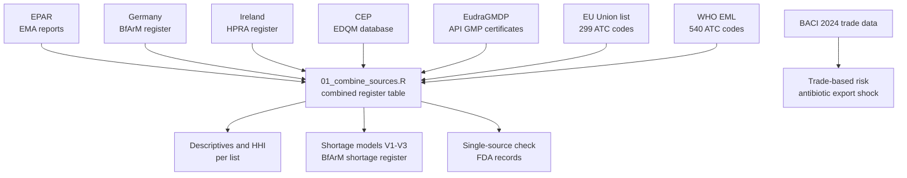

# Medication Supply: Manufacturing Concentration of EU Critical and WHO Essential Medicines

This repository contains the data, code and figures for the paper by
E. Dervic, A. Pesce, L. Melnikova and P. Klimek (Supply Chain Intelligence Institute Austria,
Complexity Science Hub, Medical University of Vienna, TU Wien).

The paper builds an open dataset of manufacturing sites for the medicines on two lists, the EU
Union list of critical medicines (299 ATC codes) and the WHO Model List of Essential Medicines
(540 ATC codes, 187 of them on both lists), from five public sources: the EMA's European Public
Assessment Reports (EPAR), the German BfArM manufacturer register, the Irish HPRA product
register, the EDQM database of Certificates of Suitability (CEP) and the EudraGMDP database of GMP
certificates. It uses the dataset to measure how geographically concentrated the manufacturing of
each medicine is, to relate that concentration to current shortages in Germany, to check
single-source medicines against FDA records, and to estimate how exposed EU member states are to a
halt in Chinese and Indian antibiotic exports.

## Table of Contents

- [Overview](#overview)
- [Repository structure](#repository-structure)
- [Data](#data)
- [How to reproduce](#how-to-reproduce)
- [Methods and scripts](#methods-and-scripts)
- [Paper figures and tables](#paper-figures-and-tables)
- [Data collection](#data-collection)
- [Independent replication (Python)](#independent-replication-python)

## Overview



| Paper section | Status in this repository |
|---|---|
| Data overview, manufacturing registers and HHI (figures, coverage, Supplementary HHI table) | scripts and inputs included |
| Shortage models V1 and V2 (German register alone, German register + EPAR), all three lists | reproduces the paper exactly |
| Shortage models V3 (+ CEP + EudraGMDP), main-text Table 3 and V3 columns of the Supplementary tables | reproduces the paper |
| Irish register as base register (Supplementary) | V1 and V2 reproduce the paper (terms the paper reports as not estimable appear in the CSV with extreme odds ratios); V3 from the same inputs as the German-register V3 |
| Antibiotic consumption (ECDC) and treemap of the two lists | scripts and data included |
| Trade-based risk comparison (BACI) | notebook and figures included; its input data are not stored in the repository |
| Single-source medicines and alternative capacity (FDA cross-check, Table 2) | not included |
| Counts and percentages of the Data overview and Table 1 (entries, manufacturers, countries, Gini coefficient, cross-source correlations) | not produced by a script in this repository |

## Repository structure

```
data/
├── registers/
│   ├── raw/           manufacturer registers and the two medicine lists (inputs, read-only)
│   └── processed/     combined register table and helper tables written by 01_combine_sources.R
├── shortages/         BfArM shortage reports, pulled 9 September 2026
├── consumption/       ECDC antibiotic (J01) consumption, one file per year 2016–2024
├── trade/             trade-analysis inputs (git-ignored, see "Inputs not stored in the repository")
└── replication/       inputs of the independent Python replication
scripts/
├── registers/         R analysis of the registers
│   ├── run_all_lists.R          runs the whole R pipeline
│   ├── paths.R                  every input and output folder
│   ├── 01_combine_sources.R     builds the combined register table
│   ├── PlotbySource_V2.R  bubblePlot.R  atc_summary_report_plot.R  HHI_V2.R
│   ├── api_diversification_by_source.R  IndiaChina_Steps_V2.R
│   └── Shortage.R  Ireland_Shortage.R  02_shortage_models_all_lists.R  TreeMaps.R
├── descriptives/      02_antibiotic_consumption.R
├── trade/             baci_systemic_risk.ipynb (trade-based risk, Python)
├── data_collection/   scrapers and download scripts that produced the raw register files
└── replication/       Python replication pipeline
figures/               figures of the paper, file names as in the manuscript (written by run_all_lists.R)
├── trade/             trade figures of the paper and the Supplementary Information
└── additional/        consumption heatmap and small multiples
results/
├── EU/  WHO/  overlap/     every output of the per-list scripts, file names ending in _EU, _WHO, _overlap
├── IrelandShortage/        shortage models with the Irish register as base register
├── tables/                 antibiotic consumption summary
└── replication/            tables and figures of the Python replication
```

`overlap` denotes the medicines on both lists.

## Data

### Medicine lists

| File in `data/registers/raw/` | Content |
|---|---|
| `critical.csv` | the 299 ATC level-5 codes of the Union list of critical medicines (EMA and the Medicine Shortages Steering Group) |
| `eml_export.xlsx` | export of the WHO Model List of Essential Medicines: medicine, section, formulations, ATC codes and status. The analysis uses the 540 ATC codes on current (`Added`) rows, 535 at level 5 and 5 at level 4; a register code under one of the level-4 codes counts as essential |

### Manufacturer registers

Each source has a file restricted to the EU list (used for every code on the EU list) and, except
CEP, a second file used only for codes that are on the WHO list but not on the EU list.

| Source | EU-list file | WHO-only file | Collected |
|---|---|---|---|
| EPAR (EMA product information, Annex II) | `EMA_data_critical.csv` | `data.csv` (all centrally authorised medicines, semicolon-separated) | May 2026 (EU-list file) |
| Germany (BfArM, AMGuiFree) | `bfarm_api_origin_critical_rest_LONG.csv` | `bfarm_api_origin_eml_LONG.csv` | 25–26 June 2026 (EU list) |
| Ireland (HPRA) | `ireland_critical_atc_review.csv` | `hpra_final.csv` | 2026 |
| CEP (EDQM) | `EXPORT_WEB_CEP_with_ATC_drugbank.csv` (all certificates, ATC codes attached via DrugBank) | — | August 2026 |
| EudraGMDP (API GMP certificates) | `Critical_API_sites_activities_LONG.csv` | `gmdp_EML_API_sites_activities_LONG.csv` | June 2026 |

`EXPORT_WEB_CEP.txt` is the raw EDQM export from which the CEP file was built.

The BfArM files list one row per product × role × company. Roles are *Zulassungsinhaber*
(marketing-authorisation holder), *Wirkstoffherstellung* (active-substance manufacture),
*Hersteller/Endfreigabe* (manufacture and batch release), *Vertreiber* (distributor) and
*Örtlicher Vertreter* (local representative); only the two manufacturing roles are used. Country
names are in German. The register files were checked by hand after collection and some rows were
corrected, so re-collecting them today does not give the same files.

### EudraGMDP

The EudraGMDP data were built in three steps. `scripts/data_collection/EudraGMDP/scrape_eudragmdp_2026.py`
downloads every compliant GMP certificate (snapshot of 23 June 2026) into JSON files with the sites,
certificate types, substances and API activity codes. A conversion step, which is not in this
repository, matched the substances to ATC codes and wrote one row per site × certificate × activity:
`gmdp_EML_API_sites_activities_LONG.csv` for the WHO list and `Critical_API_sites_activities_LONG.csv`
for the EU list. The EU-list file was then edited extensively by hand, so re-running the scraper
and a new conversion does not give the same file. Both files are in `data/registers/raw/`;
`01_combine_sources.R` takes the EudraGMDP sites of EU-list codes from
`Critical_API_sites_activities_LONG.csv` and those of WHO-only codes from
`gmdp_EML_API_sites_activities_LONG.csv`.

### Shortages

`data/shortages/LEMeldungen_2026-09-09-13-30-43.csv` is the export of all reports in the BfArM
shortage register (*Lieferengpassmeldungen*,
<https://anwendungen.pharmnet-bund.de/lieferengpassmeldungen/>), pulled on 9 September 2026:
739 reports, semicolon-separated, Latin-1 encoded, with the ATC code(s), start and expected end of
each shortage.

### Antibiotic consumption

`data/consumption/` holds nine files exported from the ECDC Antimicrobial Consumption (AMC)
database, one per year from 2016 to 2024: consumption of antibacterials for systemic use (ATC J01)
per EU/EEA country in defined daily doses (DDD) per 1,000 inhabitants per day. The year is read from
the file name.

### Trade

The trade analysis uses CEPII's BACI database (2024), restricted to the four HS-6 lines that carry
antibiotic active substances: 294110 (penicillins), 294130 (tetracyclines), 294150 (erythromycin and
macrolides) and 294190 (other antibiotics).

### Inputs not stored in the repository

| File | Content | How to obtain |
|---|---|---|
| `data/registers/raw/DrugBank_FullDatabase.xml` | DrugBank full database, 795 MB; its licence does not permit redistribution | Create a free academic account at <https://go.drugbank.com/releases/latest> and download "All drugs" (XML). Only the CEP scripts in `scripts/data_collection/CEP/` read it. |
| `data/trade/baci_2024_antibiotics_bilateral.csv` | BACI 2024 flows for the four HS-6 lines: `year`, `hs6_code`, `exporter_iso3`, `exporter_name`, `importer_iso3`, `importer_name`, `value_1000_usd`, `quantity_tonnes` | Download BACI (HS-6) from <https://www.cepii.fr/CEPII/en/bdd_modele/bdd_modele_item.asp?id=37> and keep the 2024 rows for HS 294110, 294130, 294150 and 294190. |
| `data/trade/cep_antibiotics_clean.csv` | valid CEPs for the four antibiotic HS-6 classes, with holder country | Run `scripts/data_collection/CEP/download_cep.py` and `cep_clean.ipynb` (the paper uses the CEP export of 28 July 2026) and copy the output here. |
| `data/registers/raw/bfarm_api_origin_critical_J01_LONG.csv` | BfArM register for the 35 J01 antibiotics, read by section 6 of the trade notebook (not in the paper) | `python scrape_bfarm_api_origin.py --j01` in `scripts/data_collection/BfArM/` |
| `data/shortages/Medicines_output_shortages_en.json`, `data/shortages/ema_shortages_atc_crosswalk.csv` | EMA shortage list and its ATC crosswalk, read only by `Shortage.R` with `OUTCOME = "GermanyEMA"` (not in the paper) | EMA shortages download |
| `data/trade/sys_risk/*.parquet` | systemic trade risk scores (`str`) per HS code, importer and exporter | From a separate systemic-risk pipeline. The notebook loads them in its setup cell for the risk-adjusted (`str`) variants. |

## How to reproduce

Requirements: R ≥ 4.3 and, for the trade notebook and the replication, Python ≥ 3.11.

```r
install.packages(c("readr", "readxl", "dplyr", "tidyr", "stringr", "purrr", "janitor", "ggplot2",
                   "patchwork", "scales", "ggrepel", "ggh4x", "hexbin", "tidytext", "forcats",
                   "treemapify", "xtable", "lubridate", "broom", "car", "pROC", "MASS", "jsonlite"))
```

On macOS with a Homebrew R, `car` builds its dependency `nloptr` from source, which needs CMake
(`brew install cmake`).

From the repository root:

```bash
Rscript scripts/registers/run_all_lists.R
```

This runs, in about four minutes:

1. `01_combine_sources.R`, which writes `data/registers/processed/manufacturer_registers_combined.csv`;
2. for each list (EU, WHO, overlap): `PlotbySource_V2.R`, `bubblePlot.R`, `atc_summary_report_plot.R`,
   `HHI_V2.R`, `api_diversification_by_source.R`, `IndiaChina_Steps_V2.R`,
   `Shortage.R` and `Ireland_Shortage.R`, writing to `results/<list>/` and `results/IrelandShortage/`;
3. `TreeMaps.R`, `02_shortage_models_all_lists.R` and `scripts/descriptives/02_antibiotic_consumption.R`;
4. copies the figures of the paper from `results/` to `figures/` under their manuscript names.

Lists given on the command line override the default of all three
(`Rscript scripts/registers/run_all_lists.R WHO`); the switches at the top of `run_all_lists.R`
turn the individual steps on or off. Every script reads its folders from `scripts/registers/paths.R`
and can also be run alone from the repository root once `01_combine_sources.R` has run, e.g.
`LIST <- "WHO"; source("scripts/registers/HHI_V2.R")`.

**Locale.** The country-name maps contain non-ASCII names ("Vereinigtes Königreich", "Österreich").
The scripts write them as `\u` escapes inside `setNames()`, so they are matched in any locale,
including the C locale of a bare `Rscript`; `paths.R` also switches to `en_US.UTF-8` where it can,
so that plot labels with non-ASCII characters render. `run_all_lists.R` stops if no UTF-8 locale
is available. Every script, run alone or through `run_all_lists.R`, writes the same files.

**Reproducibility.** Label placement and the jitter of the shortage diagnostic plots are seeded, so
repeated runs give byte-identical CSV, LaTeX and PNG files (apart from the date line xtable writes
into the `.tex` files).

The trade notebook needs Python with `pandas numpy scipy matplotlib pyarrow jupyter` and its input data:

```bash
cd scripts/trade && jupyter nbconvert --to notebook --execute --inplace baci_systemic_risk.ipynb
```

## Methods and scripts

### Combining the registers — `01_combine_sources.R`

Writes `data/registers/processed/manufacturer_registers_combined.csv`: one row per ATC code ×
manufacturer × country × manufacturing step × source, with the flags `on_eu_list` and `on_who_eml`,
the ATC level-1 chapter and the world region of the manufacturer's country. It also writes
`list_codes.csv` (every code on either list), `who_eml_coverage_by_source.csv`,
`who_eml_medicines_without_atc.csv` and `germany_eml_codes_without_bfarm_result.csv` to the same
folder.

- **Lists.** EU-list codes come from `critical.csv`; WHO codes from the ATC codes of the current
  (`Added`) rows of the EML export. EML medicines without an ATC code are excluded.
- **EU and WHO-only files.** Codes on the EU list use the EU-list file of each source only; the
  WHO-only files fill in codes that are on the WHO list alone, so EU and overlap results do not
  depend on them (`TOPUP_EU_CODES <- FALSE`).
- **EPAR.** Manufacturer name, country and step as published.
- **Germany.** Only *Wirkstoffherstellung* (step 1) and *Hersteller/Endfreigabe* (step 2) are kept;
  marketing-authorisation holders, distributors and local representatives are dropped. German
  country names are translated to English.
- **Ireland.** The parallel "|"-separated manufacturer and country lists are paired element by
  element; rows where the two lists differ in length are kept unsplit. No step information.
- **CEP.** Cells with several ATC codes are split; the holder's country is the trailing ISO-2 code
  of the holder field. All holders count as step 1.
- **EudraGMDP.** Valid API certificates only; a site is kept for a code if it is certified for
  manufacture or processing of the substance (activity codes 3.1–3.4 and 3.5.1), not for packaging
  or testing only. All sites count as step 1.
- **Regions.** China, India, other Asia & Oceania, North America, non-EU Europe, rest of the world
  (Latin America and Africa), and the EU/EEA as reference.

### Step-1 priority

EPAR and Germany distinguish active-substance manufacture (step 1) from finished-product
manufacture and batch release (step 2). For the concentration measures, step-1 records are used for
every ATC code with at least one of them, and step-2 records only for codes without any. CEP and
EudraGMDP contain step-1 manufacturers only; Ireland has no step field and all its manufacturers
are used.

### Descriptive and concentration figures

All scripts run once per list and write to `results/<list>/`, with the list appended to every file name.

| Script | What it computes |
|---|---|
| `PlotbySource_V2.R` | ATC codes, manufacturers and countries per source; manufacturers and countries per ATC code; top 10 countries; the Irish register separately |
| `bubblePlot.R` | unique sites (dot size) and ATC codes (colour) per country × ATC chapter, per source; non-EU/EEA countries in bold |
| `atc_summary_report_plot.R` | distinct manufacturers against distinct countries per ATC code (hexagonal bins), per source |
| `HHI_V2.R` | country-level HHI per ATC code and source, its distribution and its breakdown by ATC chapter, and how often each source gives the highest HHI (`hhi_highest_by_source_<list>.tex`) |
| `api_diversification_by_source.R` | per substance, distinct API sites against the share of those sites in China or India |
| `IndiaChina_Steps_V2.R` | share of unique sites per ATC chapter in China, India, the EU/EEA and elsewhere, by step |
| `TreeMaps.R` | ATC codes per ATC level-1 chapter on each list |
| `scripts/descriptives/02_antibiotic_consumption.R` | J01 consumption per country and year, EU/EEA mean with country trajectories, heatmap, small multiples and a per-country summary in `results/tables/` |

For each ATC code and source the Herfindahl-Hirschman Index is

$$\mathrm{HHI} = 10\,000 \sum_{i=1}^{n} s_i^2,$$

where $s_i$ is the share of the code's manufacturing sites in country $i$. The dashed lines in the
figures mark 1,500 and 2,500.

### Shortage models — `Shortage.R`, `Ireland_Shortage.R`, `02_shortage_models_all_lists.R`

- **Outcome.** Multi-code cells of the BfArM shortage register are split. Reports with only an ATC
  level-4 code (21) or no ATC code (16) are dropped. A code is *currently in shortage* if any of its
  reports started on or before 9 September 2026 and has no end date or ends on or after it.
- **Manufacturer data.** V1: the German register; V2: Germany + EPAR; V3: Germany + EPAR + CEP +
  EudraGMDP, with company names harmonised (lower case, no punctuation or legal-form suffixes,
  combined with the country) so that a site listed in several registers counts once. Step-1
  priority as above.
- **Models.** Logistic regression of shortage status on log(1 + manufacturers), HHI/10,000 and either
  the combined China + India share (pooled model) or the shares of the six regions with the EU/EEA as
  reference (regional model). Likelihood-ratio tests, profile-likelihood confidence intervals,
  McFadden's pseudo-R², in-sample AUC, shortages per predictor and variance inflation factors.
  Terms affected by quasi-complete separation are reported as not estimable.
- `Shortage.R` writes all models per list to `results/<list>/shortage_models_V1_V2_V3_<list>.csv`
  together with the per-code table `atc_shortage_concentration_analysis_<list>.csv`.
  `Ireland_Shortage.R` runs it with the Irish register in place of the German one
  (`results/IrelandShortage/`). `02_shortage_models_all_lists.R` fits the models for all three lists
  and writes the Supplementary tables `results/shortage_models_all_lists.tex` (pooled) and
  `results/shortage_models_all_lists_regional.tex` (regional).

### Trade-based risk — `scripts/trade/baci_systemic_risk.ipynb`

Python notebook (pandas, numpy, scipy, matplotlib, pyarrow). It builds the sourcing-share matrix $S$
(each importer's import shares by exporter, pooled over the four HS-6 lines, by value and by volume)
and then computes, in order:

Shares are computed by value and by volume, and for the comparisons that need only imports also by
risk-adjusted value (`str`). Then, in order:

1. sourcing similarity: pairwise cosine similarity of EU-27 sourcing profiles, and (1b) a
   marginal-preserving null model with 1,000 permutations;
2. import exposure, imports / (imports + exports);
3. largest supplier and supplier concentration (HHI of import shares) per EU-27 country;
4. the fragility map, exposure against supplier concentration;
5. the China + India export-stop shock, direct and propagated through intermediaries,
   $x = (I - P)^{-1} a$ with $P = \mathrm{diag}(\text{exposure})\,S$, by value and volume, and (5b) a
   marginal-preserving null test (500 permutations) of the indirect part;
6. German register (BfArM, J01) against German imports (not in the paper);
7. CEP holders against EU-27 imports, with (7b) the non-EU split of Supplementary Table `cep_split`;
8. an exploratory unit-value screen (not in the paper).

The notebook resolves all paths from its own folder, so run it from `scripts/trade/`. It reads its
inputs from `data/trade/` and writes figures to `figures/trade/`. The figures in `figures/trade/` are those
in the manuscript, and the notebook keeps the outputs of its last run.

## Paper figures and tables

Main text:

| In the paper | File | Script |
|---|---|---|
| Table `tab:datasets` — coverage per source | console output (`n_atc_codes`) | `PlotbySource_V2.R` |
| Table `tab:datasets` — entries, manufacturers, countries | — | not included |
| Table `tab:single_source` — single-source medicines and FDA records | — | not included |
| Figs. `fig:hhi_step1_priority_by_source`, `fig:hhi_step1_priority_by_sourceWHO` | `figures/hhi_step1_priority_by_source_EU.png`, `_WHO.png` | `HHI_V2.R` |
| Figs. `fig:manufacturing_sites_by_chapter_country_group_source`, `…WHO` | `figures/manufacturing_sites_by_chapter_country_group_source_EU.png`, `_WHO.png` | `IndiaChina_Steps_V2.R` |
| Fig. `fig:api_diversification_germany` | `figures/api_diversification_Germany_EU.png` | `api_diversification_by_source.R` |
| Table `tab:shortage_regional_v3` | `results/shortage_models_all_lists_regional.tex` (V3 columns) | `02_shortage_models_all_lists.R` |
| Fig. `fig:exposure_fragility` (a), (b) | `figures/trade/exposure_volume.png`, `fragility_volume.png` | trade notebook, §2, §4 |
| Fig. `fig:shock` | `figures/trade/shock_volume.png` | trade notebook, §5 |
| Fig. `fig:eu_antibiotic_trend` | `figures/eu_average_trend.png` | `02_antibiotic_consumption.R` |
| Fig. `fig:plots_by_source` | `figures/plots_by_source_EU.png` | `PlotbySource_V2.R` |

Supplementary Information:

| In the SI | File | Script |
|---|---|---|
| Fig. `fig:treemap_chapters` | `figures/plot4_treemap_chapters_eu_who.png` | `TreeMaps.R` |
| Figs. `fig:hhi_by_chapter_by_source`, `…WHO` | `figures/hhi_by_chapter_by_source_EU.png`, `_WHO.png` | `HHI_V2.R` |
| Figs. `fig:atc_summary_report`, `…WHO` | `figures/atc_summary_report_plot_v2_EU.png`, `_WHO.png` | `atc_summary_report_plot.R` |
| Figs. `fig:bubble_matrix_by_source`, `…WHO` | `figures/bubble_matrix_by_source_EU.png`, `_WHO.png` | `bubblePlot.R` |
| Table `tab:hhi_highest_by_source` | `results/EU/hhi_highest_by_source_EU.tex`, `results/WHO/hhi_highest_by_source_WHO.tex` | `HHI_V2.R` |
| Table `tab:si_shortage_regional` | `results/shortage_models_all_lists_regional.tex` | `02_shortage_models_all_lists.R` |
| Table `tab:si_shortage_pooled` | `results/shortage_models_all_lists.tex` | `02_shortage_models_all_lists.R` |
| Fig. `fig:data_ireland` | `figures/data_ireland_EU.png` | `PlotbySource_V2.R` |
| Fig. `fig:hhi_ireland` | `figures/hhi_step1_priority_Ireland_EU.png` | `HHI_V2.R` |
| Table `tab:si_shortage_pooled_ireland` | `results/IrelandShortage/shortage_models_V1_V2_V3_Ireland_<list>.csv` (model `main`) | `Ireland_Shortage.R` |
| Table `tab:cep_split` | printed by the notebook | trade notebook, §7b |
| Fig. `fig:cep_trade_scatter` | `figures/trade/cep_vs_trade_scatter_volume_spearman.png` | trade notebook, §7 |
| Figs. `fig:single`, `fig:single_val` | `figures/trade/single_sourcing_volume.png`, `single_sourcing_value.png` | trade notebook, §3 |
| Fig. `fig:cosinenull` | `figures/trade/cosine_null.png` | trade notebook, §1b |
| Figs. `fig:exposure_val`, `fig:fragility_val`, `fig:shock_val` | `figures/trade/exposure_value.png`, `fragility_value.png`, `shock_value.png` | trade notebook, §2, §4, §5 |
| Fig. `fig:cosine` | `figures/trade/cosine.png` | trade notebook, §1 |

The per-source variants of the figures, the step figures, the shortage diagnostic plots and the
CSV tables behind every figure are in `results/<list>/`.

## Data collection

`scripts/data_collection/` contains the scripts that produced the raw register files. They are not
part of `run_all_lists.R`: they scrape live websites, take hours, and their output was checked and
corrected by hand before it became the files in `data/registers/raw/`. A new run gives the current
state of each register, not the snapshot used in the paper. See `scripts/data_collection/README.md`
and the README in each subfolder.

| Register file | Produced by |
|---|---|
| `EMA_data_critical.csv`, `data.csv` | `EPAR/ema_epar_pipeline.ipynb`: downloads the EMA medicines table, finds each medicine's product-information PDF, extracts the Annex II manufacturer blocks, parses name, address, country and step, and geocodes addresses |
| `bfarm_api_origin_critical_rest_LONG.csv`, `bfarm_api_origin_eml_LONG.csv` | `BfArM/scrape_bfarm_api_origin.py`: opens the detail page of every product authorised in Germany for each code and records every company with its role and country |
| `ireland_critical_atc_review.csv`, `hpra_final.csv` | `HPRA/hpra_scraper.ipynb`: collects product information and package-leaflet links, downloads the leaflets and extracts manufacturer, address and country |
| `EXPORT_WEB_CEP.txt` | `CEP/download_cep.py`: the EDQM "download the online certification database" export |
| `EXPORT_WEB_CEP_with_ATC_drugbank.csv` | `CEP/cep_atc_drugbank.R`: keeps valid certificates, matches substance names to DrugBank names and synonyms to get ATC codes, drops level-3/4 combination-product codes, cross-checks the remaining codes against NLM RxNav/RxClass, keeps the codes on the EU list and attaches them to every row of the export |
| `gmdp_EML_API_sites_activities_LONG.csv`, `Critical_API_sites_activities_LONG.csv` | `EudraGMDP/scrape_eudragmdp_2026.py`: downloads all compliant GMP certificates from EudraGMDP with site, country, certificate type, substances and API activity codes, as JSON. The conversion of the JSON to these files (substance → ATC code, one row per activity) is not in this repository, and the EU-list file was also edited by hand |

## Independent replication (Python)

`scripts/replication/` is a second, independently written pipeline. It is not used for any number in
the paper. It rebuilds substance-level supply from separately obtained public data and
computes the same country-level concentration measures. It shows that the register results do not hinge
on the hand-curated files above.

| Source | Codes (registers) | Codes (replication) | Codes in both | Spearman ρ, HHI | Spearman ρ, number of countries | Same number of countries | Single-country share (registers / replication) |
|---|---|---|---|---|---|---|---|
| CEP | 79 | 169 | 79 | 0.80 | 0.86 | 57 % | 10 % / 5 % |
| EPAR | 51 | 100 | 50 | 0.81 | 0.84 | 64 % | 42 % / 34 % |

The replication covers more codes because it maps substance names to ATC codes through several
sources rather than DrugBank alone. It does not include the German register. HPRA publishes no
manufacturer country, so the Irish layer cannot enter country measures.

### Setup and run

```bash
python -m venv venv && source venv/bin/activate
pip install -r requirements.txt
```

```bash
python scripts/replication/01-data-prep/fetch.py
```

Downloads the three automatically fetchable sources into `data/replication/raw/` and records URL,
time and SHA-256 of each in `manifest.json`. The committed snapshot was fetched on 20 September 2026.
Running `fetch.py` again replaces it with today's versions.

| File in `data/replication/raw/` | Content | How it is obtained |
|---|---|---|
| `ulcm.xlsx` | Union list of critical medicines (EMA) | `fetch.py` |
| `ema_medicines.xlsx` | EMA medicines report, used only for substance → ATC codes | `fetch.py` |
| `hpra_products.xml` | HPRA human-medicines list (`latestHMlist.xml`) | `fetch.py` |
| `edqm_cep.txt` | EDQM CEP export | downloaded by hand on 23 August 2026, see `common/config.py` |
| `manufacturers.csv` | EPAR Annex II manufacturers with geocoded addresses | copied from an earlier project that scraped the EPAR product-information PDFs |

```bash
python scripts/replication/01-data-prep/inspect_sources.py > results/replication/schema_report.txt
python scripts/replication/01-data-prep/build_supply.py
python scripts/replication/02-analysis/analyse.py
python scripts/replication/03-figures/plots.py
python scripts/replication/02-analysis/qc.py
python scripts/replication/04-comparison/compare_with_registers.py
```

| Step | Output |
|---|---|
| `build_supply.py` | `data/replication/interim/supply_long.csv`: one row per substance × supplier × country × role (`api_cep`, `bio_api`, `batch_release`, `mah_national`) |
| `analyse.py` | `results/replication/`: `summary.txt`, `substance_supply.csv`, `country_totals.csv`, `distribution.csv`, `sensitivity.csv`, `atc_supply.csv`, `atc_chapter_totals.csv` |
| `plots.py` | `results/replication/figures/`: counterparts of the register figures, with role in place of source |
| `qc.py` | PASS / WARN / FAIL checks on country resolution, ATC coverage and format, duplicates, normalisation and Union-list coverage; exits non-zero on failure |
| `compare_with_registers.py` | `results/replication/comparison_with_registers.csv`: the table above; reads `results/EU/hhi_step1_priority_final_EU.csv`, so `run_all_lists.R` must have run first |

### Design decisions

- **ATC codes.** Only EPAR and HPRA publish ATC codes. CEP rows get theirs from a substance, so ATC
  map are assembled from the Union list, the EPAR manufacturers file, the EMA medicines report and the
  register CEP file. Rows are not exploded per code, and codes are kept at the level the source
  published them. Coverage is 76.6 % of rows: 99 % for EPAR and HPRA, 32 % for CEP. The CEP figure is
  the ceiling of matching against Ph. Eur. monograph titles.
- **HPRA has no country.** The XML has no address field, and resolving bare company names is wrong:
  legal-form suffixes read as ISO codes (`Teva SA` to Saudi Arabia). `country_iso2` is therefore left
  empty for the `mah_national` role. That role is excluded from every country measure via
  `COUNTRY_ROLES` in `config.py`, but still counts towards substance and ATC coverage.
- **HPRA XML parsing.** Repeated fields sit in container elements (`<ActiveSubstances>`), which
  `pandas.read_xml` does not flatten. `build_hpra` walks the children directly.
- **API diversification** is restricted to Union-list substances. Without that filter, CEP substance
  strings carrying process descriptions ("Acetazolamide, process B") produce spurious single-supplier
  substances.